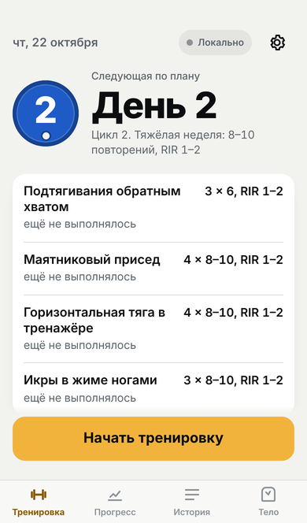
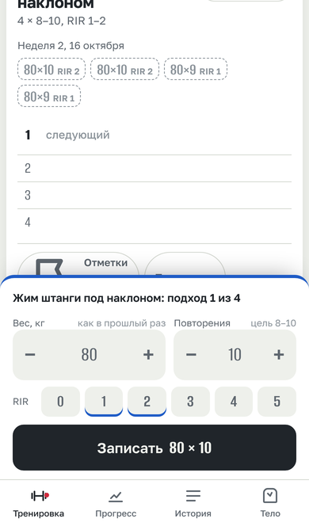
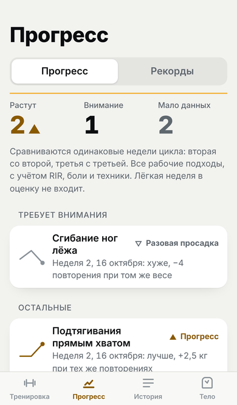
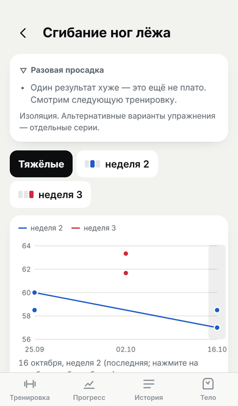

# Тренировки — трекер силовых тренировок

Личное приложение для записи тренировок с iPhone прямо в зале: открыл, увидел сегодняшнюю тренировку и прошлые результаты, записал подход в одно-два касания. Работает без интернета, всё сохраняет на телефоне и синхронизирует с Google Таблицей, когда появляется связь.

**Версия 1.0.1** — патч после первой тренировки (v1.0.0 — первая стабильная, принята на iPhone 17.10.2026).
Приложение: **https://draineroff.github.io/Training/** · [что нового](CHANGELOG.md) · [дорожная карта](ROADMAP.md) · [как выходят обновления](docs/RELEASING.md)

<p>




</p>

<sub>На скриншотах — тестовые данные из `tests/fixtures`.</sub>

## Как устроено

```
iPhone (приложение на экране «Домой»)
 ├─ приложение целиком хранится в кэше Service Worker → запускается в авиарежиме
 ├─ все данные — в IndexedDB на телефоне, каждое изменение сразу пишется на диск
 └─ очередь изменений ──(когда есть связь)──► Google Apps Script (веб-приложение)
                                                └─► ваша Google Таблица, новые листы App_*
```

* **Интерфейс** — статическое PWA (Preact + htm, без сборки), лежит в `app/`. Хостинг — GitHub Pages (бесплатно; CI публикует после тестов). Сервер не нужен.
* **Хранилище** — Google Таблица, как вы хотели: читается ChatGPT через Google Drive. Скрипт `apps-script/Code.gs` создаёт **только новые листы** `App_Sets`, `App_Sessions`, `App_Metrics`, `App_Records`, `App_Exercises`, `App_Program`, `App_Summary`. Существующие 8 вкладок не изменяются.
* **Почему не «чистый» Apps Script Web App:** страница из Apps Script открывается внутри iframe на домене googleusercontent.com, не может зарегистрировать Service Worker и не запускается без интернета. Требование «работать офлайн после закрытия» так не выполнить. Поэтому Apps Script используется только как маленький API синхронизации. Подробно — [docs/ARCHITECTURE.md](docs/ARCHITECTURE.md).

## Что проверено и что нет — честно

Проверено автотестами (`npm run test:all`: 163 unit- и серверных тестов + 50 сквозных сценариев; в CI — на каждый PR и каждый push в `main`):

* логика периодизации, выбор следующей тренировки, подсказки прошлых результатов;
* аналитика: сравнение одинаковых недель цикла, разовая просадка ≠ плато, регресс, боль/техника/«новая точка отсчёта», альтернативы как отдельные серии;
* реальный `Code.gs`, запущенный в Node на эмуляции Google Sheets: идемпотентная запись, «последняя версия побеждает», старые листы не трогаются, текст не превращается в формулы;
* сценарий в зале в Chromium с эмуляцией iPhone 13: перенос веса между подходами, правка отдельного подхода, отмена, замена упражнения, восстановление после перезагрузки (включая недописанный ввод), завершение;
* перенос из Google Таблицы: каждое значение сверено с ячейками и с формулами самой таблицы («Сетов», «Индекс»); повторный импорт, второй телефон и удаление не создают дублей;
* v1.0.1: исправление тренировки 18.10 на копии настоящих строк таблицы (ровно 9 подходов, те же строки, без дублей, второе устройство, офлайн, оба телефона сразу, рекорды, отмена), настройки вариантов на двух устройствах и со старым Apps Script, перенос подходов при «Заменить», двойное касание на последнем подходе, откат при ошибке записи;
* рекорды: правила отбора подходов, рекорды по числу повторений без выдуманного 1ПМ, история без потерь, ручные записи и их правка, синхронизация `App_Records` — в том числе со старой версией Apps Script (рекорды ждут на телефоне, не теряются);
* запуск и обновления: зависшая IndexedDB, испорченный кэш, обновление с опубликованных выпусков (в том числе со сборки 3f386f8, принятой на iPhone, на выпуск из `main`: данные, рекорды и таблица без изменений и дублей), блокировщики контента (реальные правила EasyList/EasyPrivacy/AdGuard), раскладка на экранах от 320×568 до 430×932;
* **авиарежим**: сервер с приложением выключен, браузер офлайн, приложение полностью закрыто и запущено заново — тренировка продолжается, данные на месте; после появления сети всё уходит в таблицу ровно один раз, даже если ответ сервера терялся.

**Ваши данные перенесены** (17.10.2026, коннекторы Google Sheets/Drive, только чтение — исходные таблицы не изменялись): настоящая программа из вкладки «Программа» и тренировка 16.10.2026 из «Дневника» — 23 подхода с весами, повторами и выбранными вариантами. Подробности и сверка с ячейками — [docs/IMPORT.md](docs/IMPORT.md).

**Проверено вручную:** реальный iPhone (Safari и приложение на экране «Домой», блокировка контента включена) с настоящими Apps Script (API 2) и Google Таблицей — приёмка v1.0.0 по [docs/ACCEPTANCE.md](docs/ACCEPTANCE.md). Автотесты идут в Chromium с эмуляцией iPhone и на эмуляции Google Sheets: настоящий Safari они не заменяют, поэтому перед каждым выпуском — короткая проверка на телефоне.

## Установка (один раз, ≈20 минут)

Пошагово, с проверкой после каждого шага и таблицей «что делать, если…» — **[docs/SETUP.md](docs/SETUP.md)**. Коротко:

1. **Приложение:** репозиторий публичный → GitHub Actions после зелёных тестов публикует `app/` из ветки `main` в ветку `gh-pages` → **Settings → Pages → Deploy from a branch → `gh-pages` / root**. Адрес: **https://draineroff.github.io/Training/**
2. **Таблица:** Расширения → Apps Script → вставить [`apps-script/Code.gs`](apps-script/Code.gs) → выполнить `setup` (листы `App_*` и ключ) → Развернуть как веб-приложение: «Запуск от имени: Я», «Доступ: Все» → URL `/exec`.
3. **iPhone:** Safari → «На экран «Домой»» → открыть с иконки → Настройки → URL и ключ → «Сохранить и проверить связь».

Публикуется только `main`: после merge и зелёных тестов новая версия выходит примерно за 5 минут. На телефоне появится «Загружена новая версия → Перезапустить». Номер сборки (первые 7 знаков коммита в `main`) виден в настройках. Порядок выпуска обновлений — [docs/RELEASING.md](docs/RELEASING.md).

### Безопасность записи в таблицу

* Изменить таблицу через API можно только с 64-символьным ключом. Он хранится в настройках скрипта и на ваших устройствах; в публичном коде и истории репозитория нет ни ключа, ни адреса API.
* Скрипт пишет только в листы `App_*`, текст не становится формулой, большие запросы отклоняются.
* Страница может отправлять данные только в Google Apps Script (CSP).
* Ключ можно сменить одной командой: таблица → «Тренировки → Сменить ключ доступа». Старый перестаёт работать сразу.
* Данные тренировок, программа и вес тела лежат в репозитории открыто — это осознанное решение.

### Программа и тренировка от 16.10.2026 — уже внутри

При первом запуске приложение один раз добавляет программу из вкладки «Программа» и тренировку 16.10.2026 из «Дневника», а на главном экране показывает, что перенесено. Повторов не будет: у записей фиксированные id, а уже введённое вручную не перезаписывается. Правила и таблица значений — [docs/IMPORT.md](docs/IMPORT.md).

Менять программу позже можно тремя способами:
* редактор в настройках;
* «Вставить программу текстом» (формат ниже, есть готовый запрос для ChatGPT);
* лист `App_Program` в таблице — приложение заберёт изменения при синхронизации.

```
День 1: Верх / руки
- Подтягивания прямым хватом [pullup]
- Наклонный жим: Hammer - наклон [hammer] / Наклонный жим: Гантели - наклон
- Икры в жиме ногами [calves] н1=3x10-12 н2=3x10-12 н3=3x10-12
```

Категории задают правила недель: `[base]` — 4 подхода в тяжёлые недели; `[hammer]`, `[pullup]`, `[iso]` — 3; `[calves]` — 3 и дроп-сет в 3-ю неделю; `[pullup]` — всегда 3×6. Варианты через ` / ` — отдельные силовые серии.

Прошлые тренировки можно добавлять и вручную: «Записать прошедшую тренировку» на главном экране или «Перенести из текста» в настройках.

## В зале

1. Открыли приложение → видна **следующая тренировка по плану**: цикл, неделя (цвет блина: 1 — зелёная лёгкая, 2 — синяя, 3 — красная), день, упражнения с прошлым результатом. «Другой день или неделя» — если нужно изменить.
2. «Начать тренировку». Внизу, под большим пальцем, — панель записи: вес, повторения, RIR, кнопка «Записать 80 × 10».
3. **Ничего не вводится дважды.** Следующий подход уже заполнен весом и повторениями предыдущего: если ничего не изменилось — одно касание. Изменить — «−/+» с шагом упражнения или касание по числу (большая клавиатура).
4. **Прошлый результат — только подсказка.** Над полями ввода строка «Прошлый раз»: этот же вариант в эту же неделю прошлого цикла. Если такой недели ещё не было — последний результат с пометкой «Другая фаза»; если вариант выполняется впервые — «Первое выполнение». Варианты не смешиваются. Первый подход предзаполнен с пометкой «как в прошлый раз» или «из другой фазы». Записывается только то, что вы подтвердили кнопкой.
5. Каждый подход хранит свой вес и повторения. Касание по записанному подходу — правка веса, повторений, RIR, отметок «дроп», «боль», «техника хуже», заметки, удаление.
6. «Заменить» — альтернатива (Hammer ↔ гантели, наклонный ↔ горизонтальный жим) или любое другое упражнение. Это отдельная серия, с исходной она не сравнивается.
7. «Отметки и комментарий»: «Боль», «Техника хуже», «Новая точка отсчёта» (стали делать строже, другие настройки тренажёра) и комментарий к упражнению в этой тренировке. Отметки влияют на аналитику, см. ниже.
8. **Заметки трёх уровней**, без больших полей на экране:
   * «Настройки» над подходами — постоянные параметры варианта (сиденье, ручки, ограничители, особенности техники). Свои у каждого варианта, видны в каждой тренировке, синхронизируются (`App_Exercises`).
   * «Отметки и комментарий» — к упражнению только в этой тренировке.
   * Значок заметки у подхода — заметка к одному подходу; закрашен, если она есть.
9. **Записали не тот вариант?** «Заменить» → нужный вариант → «Записал не то упражнение — перенести их»: подходы переходят в серию выбранного варианта, веса и повторения не меняются.
10. После последнего подхода по плану приложение само открывает следующее упражнение. Внизу 5 секунд видно «Готово» и «Отменить».
11. «Завершить тренировку» — итог со сравнением с той же неделей прошлого цикла.

**Защита данных:** каждое касание сразу сохраняется на телефоне. Даже недописанное число в панели переживает закрытие приложения. Двойное касание кнопки не создаёт два подхода. Начатая тренировка открывается сама при следующем запуске.

### Статус синхронизации (в шапке)

| Статус | Значение |
|---|---|
| ● Сохранено | всё в Google Таблице |
| ● N в очереди | сохранено на телефоне, отправится в ближайшие секунды |
| ● Офлайн | нет связи; всё на телефоне, отправится само при появлении сети |
| ● Ошибка | связь есть, но сервер отказал (например, неверный ключ) — подробности по касанию |
| ● Локально | синхронизация не настроена |

Повторная отправка безопасна: таблица ищет запись по её id, поэтому потерянный ответ и повтор не создают дубликатов.

## Аналитика: прогресс, плато, регресс

* Сравнивается **одна и та же неделя цикла**: 2-я со 2-й, 3-я с 3-й. Запланированное снижение повторений в 3-ю неделю регрессом не считается.
* **Каждый вариант упражнения — отдельная серия.** Hammer и гантели, наклон и горизонталь не смешиваются.
* Учитываются **все рабочие подходы**, а не лучший. Подходы сравниваются попарно по порядку, итог — медиана. «Хуже» засчитывается, только если хуже и медиана подходов, и общий объём на этих подходах. Дроп-сеты в сравнение не входят.
* Фактический **RIR** учитывается, если записан в обеих тренировках. Те же цифры, но легче — это прогресс.
* **Лёгкая неделя** (RIR 4–5) видна в истории, но на оценку не влияет.
* **Один неудачный результат — «разовая просадка», не плато.** «Возможное плато» — 2 сопоставимые тренировки подряд без прироста; «плато» — 3+ подряд минимум в двух циклах; «регресс» — 2 подряд хуже.
* **«Боль»** — тренировка не учитывается и не становится точкой сравнения. **«Техника хуже»** — прирост в этот день не засчитывается. **«Новая точка отсчёта»** — сравнение начинается заново, поэтому более строгая техника не превращается в ложный регресс.
* При просадке показываются возможные причины: восстановление ≤ 2/5, сон < 6 ч, ухудшение техники.
* График упражнения: точки — каждый рабочий подход, линия — медиана тренировки, синий — 2-я неделя, красный — 3-я.

Вкладка «Тело»: вес тела (среднее за 7 дней), темп набора в кг и % в неделю (по взвешиваниям за 4 недели), восстановление и сон.

## Рекорды

Прогресс → переключатель **«Рекорды»**.

* **Рекорд — наибольший вес на конкретное число повторений**, отдельно для каждого варианта упражнения: 90×6 и 85×10 — разные рекорды. Абсолютный максимум веса показан отдельно. Рекорд на 1 повторение бывает, только если такой подход действительно был; расчётный 1ПМ всегда подписан как ориентир.
* **Сами находятся в тренировках.** Подсчитываются рабочие подходы; дроп-сеты и подходы с отметками «боль» или «техника хуже» не считаются. Новый рекорд панель ввода показывает сразу: «Новый рекорд: 92,5×9».
* **Можно добавить вручную** («+»): вариант из программы, вес, повторения, дата (любая прошлая), RIR и заметка — по желанию. Ручные записи помечены «вручную», их можно изменить и удалить (с отменой). Ручная запись, повторяющая подход из тренировки, учитывается один раз.
* **История не теряется:** новый рекорд не заменяет прежний, в карточке упражнения видны все достижения с датами. Строка, которую позже перекрыл больший вес на большее число повторений, помечается «перекрыт» и не удаляется.
* **Подтягивания** сравниваются по дополнительному весу; масса тела в рекорд не входит.
* **График** — отдельная линия для каждого числа повторений. Сравнить разные повторения можно только через «1ПМ (расчёт)», и это явно подписано.
* **Оценка актуальности**: «Новый рекорд» (последние 3 недели), «Актуален», «Можно обновить» (подсказка, не ошибка), «Мало данных».
  * «Можно обновить» требует минимум двух тренировок за 6 недель. Признаки: недавно поднят больший вес на большее число повторений или расчётный уровень по последним подходам с учётом RIR выше рекордного.
  * Подходы лёгкой недели без RIR в оценку не входят, по одной тренировке выводов не делается.
  * Рядом всегда объяснение, почему выбран этот статус.

## Данные в Google Таблице (для ChatGPT)

| Лист | Что внутри |
|---|---|
| `App_Sets` | один подход — одна строка: `date, cycle, week, day, exercise, set_no, weight_kg, reps, rir, drop_set, pain, technique_worse, note`, затем технические поля |
| `App_Sessions` | тренировки: дата, цикл, неделя, день, статус, заметка, состав (`items_json`) |
| `App_Metrics` | вес тела, сон, восстановление 1–5 по датам |
| `App_Records` | рекорды, добавленные вручную: дата, упражнение, вес, повторения, RIR, масса тела (подтягивания), заметка. Рекорды из тренировок вычисляются по `App_Sets` |
| `App_Exercises` | настройки варианта упражнения: упражнение, настройки («сиденье 5, ручки 3»), ключ серии. Одна строка на вариант (с v1.0.1, Apps Script API 3) |
| `App_Program` | программа: день, порядок, упражнение, альтернативы, категория, шаг веса, особые подходы по неделям |
| `App_Summary` | читаемая сводка: одна строка на упражнение в тренировке («80×10 @2, 80×9 @1…», лучший подход, тоннаж, отметки). Пересобирается автоматически |

Удалённые записи не стираются, а помечаются `deleted = TRUE`: так удаление доходит до других устройств. Если поправить значение в `App_Sets`/`App_Sessions`/`App_Metrics`/`App_Records`/`App_Exercises` руками, приложение заберёт правку при следующей синхронизации.

## Проверка в авиарежиме на iPhone (ручной чек-лист)

1. Установить на экран «Домой», открыть с иконки, подключить таблицу, дождаться «Сохранено».
2. Полностью закрыть приложение (смахнуть из переключателя приложений). Включить **авиарежим**.
3. Открыть с иконки → приложение запускается, видна следующая тренировка.
4. Начать тренировку, записать 2–3 подхода, поправить вес одного. Статус: «Офлайн, N в очереди».
5. Снова закрыть приложение полностью и открыть: тренировка продолжается, подходы на месте.
6. Выключить авиарежим → через несколько секунд «Сохранено». В листе `App_Sets` ровно столько строк, сколько подходов.

Минимальная версия: iOS 15.4. Рекомендуется 16.4+: на ней работает «Не гасить экран».

## Разработка

```bash
npm install
npm run serve      # приложение на :5173 и локальная эмуляция Apps Script на :5174 (адрес и ключ — в консоли)
npm test           # unit + серверные тесты (Node, без браузера)
npm run test:e2e   # сквозные сценарии в Chromium (эмуляция iPhone)
npm run check:blockers  # файлы и экраны против свежих списков блокировщиков (EasyList, EasyPrivacy, AdGuard)
```

Изменения делаются в отдельной ветке и попадают на телефон только через PR и merge в `main`: CI прогоняет все тесты на PR, а после merge публикует `main`. Версии — теги `vX.Y.Z` с GitHub Release. Подробно — [docs/RELEASING.md](docs/RELEASING.md).

Имена файлов и CSS-классов не должны содержать слов из «рекламно-трекингового» словаря: `analytics`, `tracking`, `stats`, `ads`, `banner` и т. п. Блокировщики контента Safari режут такие адреса на любом сайте. Тест `tests/unit/blockers.test.js` это проверяет.

```
app/                 приложение (публикуется как есть)
  boot.js            сторож запуска: этапы, экран диагностики, восстановление файлов
tools/blockers/      проверка по спискам блокировщиков контента
  js/lib/            чистая логика: программа и правила недель, планировщик, аналитика, импорт текста
  js/data/           IndexedDB + очередь изменений, синхронизация
  js/ui/             экраны (Preact + htm)
  sw.js              офлайн-кэш приложения
apps-script/Code.gs  API синхронизации для Google Таблицы
tests/               unit, серверные (реальный Code.gs на эмуляции Sheets), e2e
docs/                архитектура и дизайн
```

Решения по архитектуре — [docs/ARCHITECTURE.md](docs/ARCHITECTURE.md), по интерфейсу — [docs/DESIGN.md](docs/DESIGN.md).
